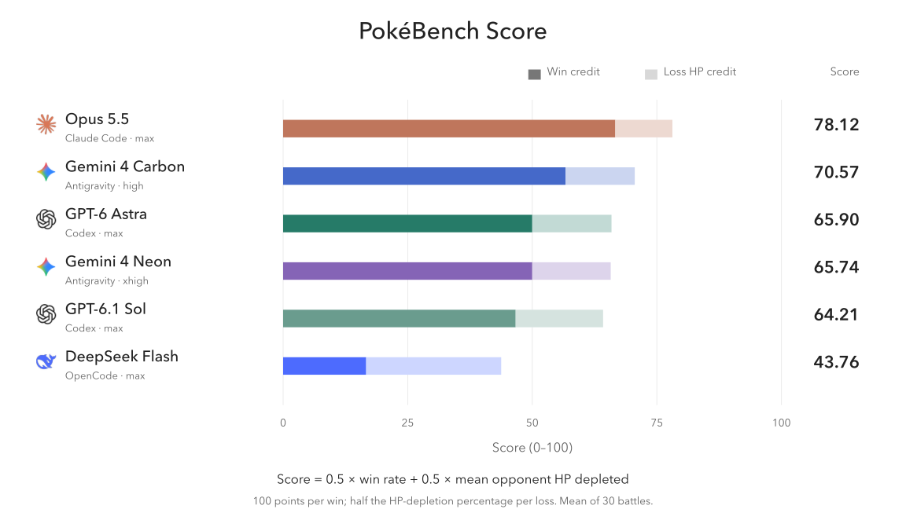
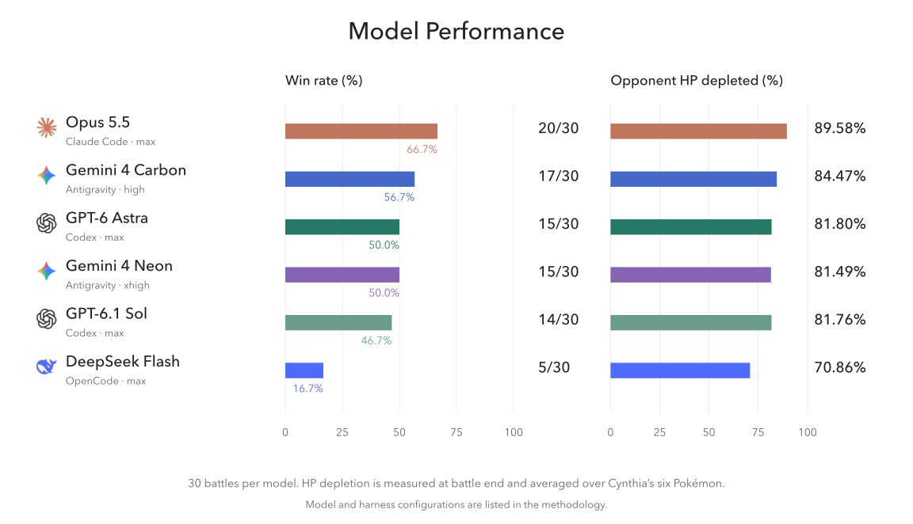
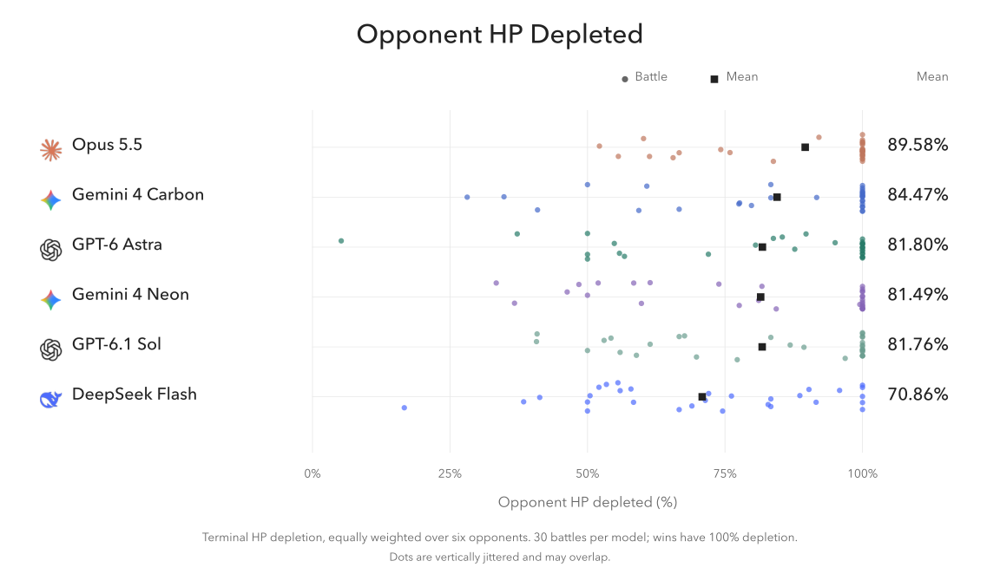
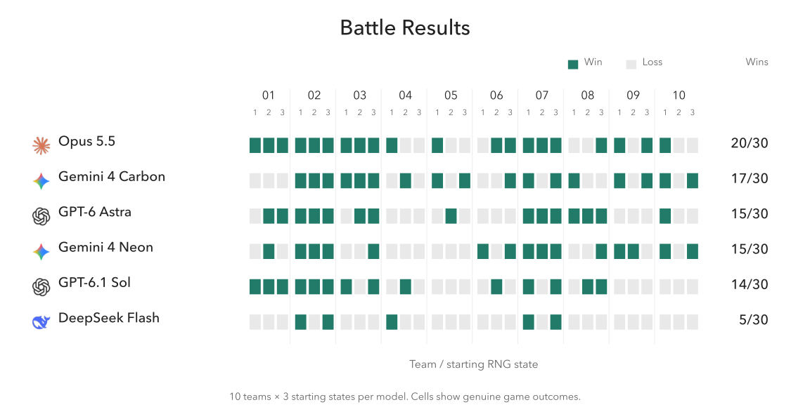

# PokéBench

Benchmark for AI agents battling the champion Cynthia in the original Pokémon Diamond. Agents use screenshots, public battle information, and game controls to play underleveled teams with limited healing supplies.

Built with [Harbor](https://harborframework.com/) for trial orchestration and host-side verification, using the [melonDS DS](https://github.com/JesseTG/melonds-ds) emulator core.



## Results

Six systems played the same **30 starting fixtures: 10 teams × 3 initial RNG states**. All 180 selected results are genuine game endings.

| Model | Harness | PokéBench Score | Wins | Mean opponent HP depleted |
| --- | --- | ---: | ---: | ---: |
| Opus 5.5 | Claude Code | **78.12** | 20/30 | 89.58% |
| Gemini 4 Carbon | Antigravity | **70.57** | 17/30 | 84.47% |
| GPT-6 Astra | Codex | **65.90** | 15/30 | 81.80% |
| Gemini 4 Neon | Antigravity | **65.74** | 15/30 | 81.49% |
| GPT-6.1 Sol | Codex | **64.21** | 14/30 | 81.76% |
| DeepSeek Flash | OpenCode | **43.76** | 5/30 | 70.86% |

**PokéBench Score = 0.5 × win rate + 0.5 × mean opponent HP depleted**, with both components expressed as percentages. Equivalently, a win earns 100 points and a loss earns half its terminal HP-depletion percentage; the score is the mean of 30 battles. This scoring rule was defined after the runs. Its formula is fixed as v1 for future cohorts.

These results compare models in their native harnesses. Tools, reasoning settings, and completion controls differ. [Methodology](docs/METHODOLOGY.md) documents those differences, the score definition, and limitations. [Results and data](docs/RESULTS.md) include every battle and the recorded system configurations.







## Tasks

Each task starts at the first decision of a six-on-six battle against Cynthia. Her Pokémon are levels 60–66. Player teams use Set mode and have 2–4 Hyper Potions, 1–2 Revives, and 1–2 Full Heals. Agents can attack, switch, use supplied items, consult public references, and run calculations. Resets, save edits, and hidden opponent state are unavailable.

The teams were constructed from human roster posts, with missing details filled in by the benchmark builder. They are not recovered player saves. [Team setup](docs/TEAMS.md) lists every Pokémon, level, move, ability, held item, medicine count, and source. The canonical payload is [teams/team-specs.json](teams/team-specs.json); [tasks/](tasks/) contains the 30 task definitions.

## Quick start

```sh
git clone https://github.com/aidank1234/pokebench.git
cd pokebench
python3.13 -m venv .venv
source .venv/bin/activate
python -m pip install -r requirements.lock.txt
python -m pip install --no-deps -e .
python scripts/summarize_results.py --check
python -m pytest -q
```

The published results can be checked without a game installation or model calls. Running battles requires Apple Silicon macOS, FFmpeg, authenticated agent CLIs, and your own original Diamond ROM and prematch save. Follow [setup](docs/SETUP.md) for the emulator build, fixture preparation, and trial commands. [Harbor integration](docs/HARBOR.md) describes the custom environment and verifier.

## Repository

- [data/results/](data/results/): battle results, system and team summaries, scoring definition, and provenance.
- [teams/](teams/) and [data/teams/](data/teams/): team specifications, source records, fixture seeds, and asset hashes.
- [src/cynthiabench/](src/cynthiabench/): emulator bridge, agent adapters, isolation, and verification.
- [scripts/](scripts/): fixture construction, trial execution, result checks, and figure generation.
- [tests/](tests/): asset-free checks and optional local game regressions.

Recordings and raw agent sessions remain outside the repository. The Python package retains the earlier `cynthiabench` name to preserve imports and fixture seed derivation.

Dependency and logo attribution is in [THIRD_PARTY.md](THIRD_PARTY.md).
