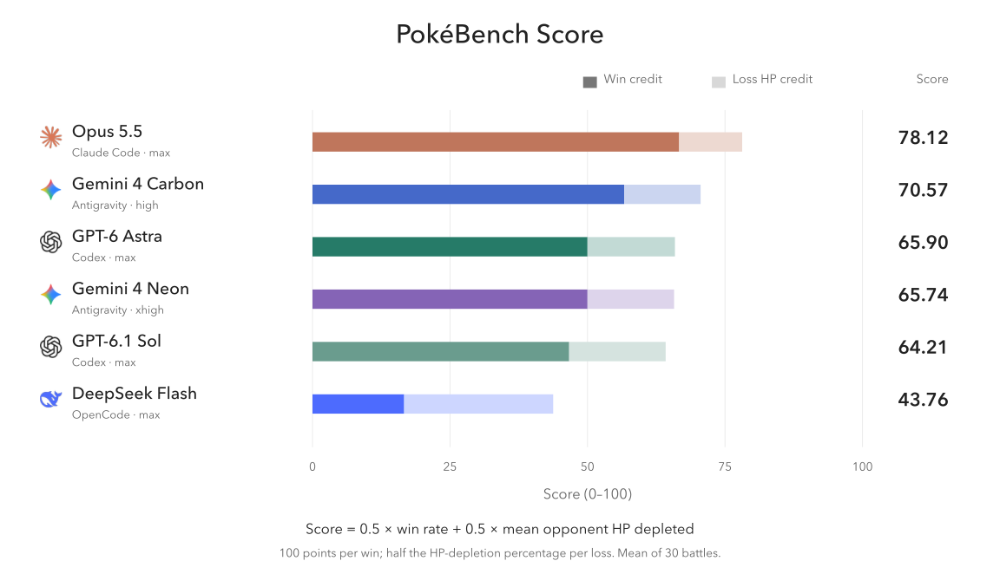
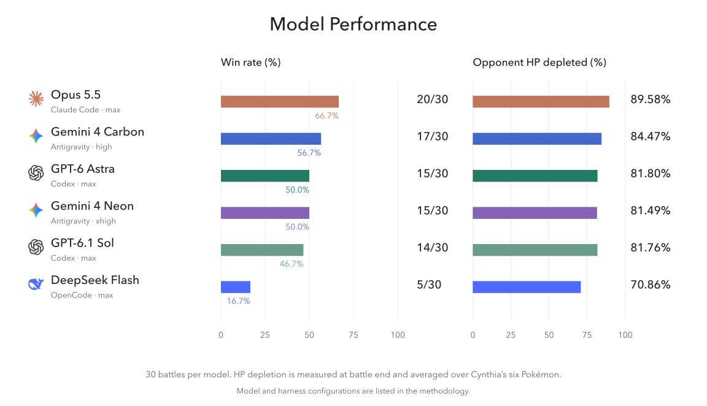
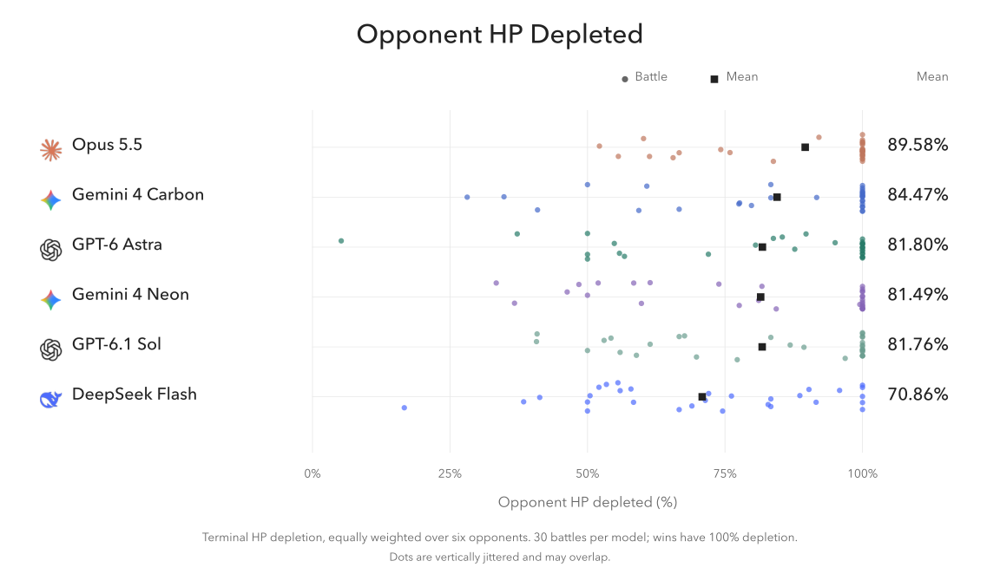
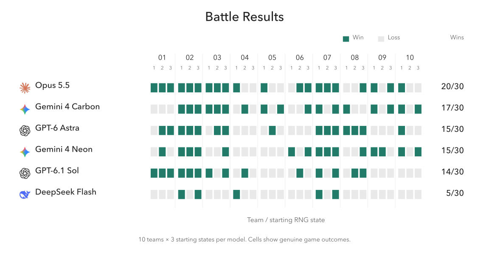

# Results

Each system uses the same 30 starting fixtures: ten teams and three initial RNG states per team.

| System | Wins | Win rate | Mean opponent HP depleted | PokéBench Score |
| --- | ---: | ---: | ---: | ---: |
| Opus 5.5 / Claude Code | 20/30 | 66.67% | 89.58% | 78.12 |
| Gemini 4 Carbon High / Antigravity CLI | 17/30 | 56.67% | 84.47% | 70.57 |
| GPT-6 Astra / Codex | 15/30 | 50.00% | 81.80% | 65.90 |
| Gemini 4 Neon XHigh / Antigravity CLI | 15/30 | 50.00% | 81.49% | 65.74 |
| GPT-6.1 Sol / Codex | 14/30 | 46.67% | 81.76% | 64.21 |
| DeepSeek Flash / OpenCode | 5/30 | 16.67% | 70.86% | 43.76 |

The selected cohort contains 180 genuine game endings: 86 wins and 94 losses.

PokéBench Score is the mean of the win percentage and mean terminal opponent HP-depletion percentage. Equivalently, each win earns 100 points and each loss earns half its HP-depletion percentage. The score was defined after these runs. [Methodology](METHODOLOGY.md) gives the formula, weighting choice and limitations.

## HP depletion

Each original opponent contributes equally: `100 × average(1 − current HP / maximum HP)`. Measurements are taken at the terminal game state. Healing can reduce this value; it is not cumulative damage. The system mean includes winning battles at 100%.

## Results by team

Each cell is wins out of the three starting states. Team specifications are in the [catalogue](TEAMS.md).

| Team | Opus 5.5 | Gemini 4 Carbon High | GPT-6 Astra | Gemini 4 Neon XHigh | GPT-6.1 Sol | DeepSeek Flash |
| --- | ---: | ---: | ---: | ---: | ---: | ---: |
| hard-01 | 3/3 | 0/3 | 2/3 | 1/3 | 3/3 | 0/3 |
| hard-02 | 3/3 | 3/3 | 3/3 | 3/3 | 3/3 | 2/3 |
| hard-03 | 3/3 | 3/3 | 2/3 | 1/3 | 2/3 | 0/3 |
| hard-04 | 1/3 | 1/3 | 0/3 | 0/3 | 1/3 | 1/3 |
| hard-05 | 1/3 | 2/3 | 1/3 | 0/3 | 0/3 | 0/3 |
| hard-06 | 2/3 | 1/3 | 0/3 | 2/3 | 1/3 | 0/3 |
| hard-07 | 3/3 | 2/3 | 3/3 | 3/3 | 2/3 | 2/3 |
| hard-08 | 1/3 | 1/3 | 3/3 | 1/3 | 2/3 | 0/3 |
| hard-09 | 2/3 | 2/3 | 0/3 | 2/3 | 0/3 | 0/3 |
| hard-10 | 1/3 | 2/3 | 1/3 | 2/3 | 0/3 | 0/3 |

## Cost records

These are usage-priced estimates, not invoiced subscription charges.

| System | Mean recorded estimate per battle | Coverage |
| --- | ---: | --- |
| Opus 5.5 | $7.99 native list-price estimate | 30 records, including recorded Haiku helper usage |
| Gemini 4 Carbon High | Unknown | No comparable per-battle dollar estimate |
| GPT-6 Astra | Unknown | No comparable per-battle dollar estimate |
| Gemini 4 Neon XHigh | Unknown | No comparable per-battle dollar estimate |
| GPT-6.1 Sol | Unknown | No comparable per-battle dollar estimate |
| DeepSeek Flash | $0.293 known subtotal | 7 complete usage records; 23 partial because failed requests returned no usage |

Cost bases differ, so no cost-efficiency ranking is reported. [Per-battle cost records](../data/results/costs.csv) distinguish known subtotals from complete estimates; blank values are unknown.

## Retained traces

| System | Native records retained outside this repository |
| --- | --- |
| Opus 5.5 | Short thinking updates; assistant text, tool calls and results |
| Gemini 4 Carbon High | ACP thought chunks; tool calls and results |
| GPT-6 Astra | No explicit reasoning-text stream in saved events; assistant commentary, commands, searches and results |
| Gemini 4 Neon XHigh | ACP thought chunks; tool calls and results |
| GPT-6.1 Sol | No explicit reasoning-text stream in saved events; assistant commentary, commands, searches and results |
| DeepSeek Flash | Returned reasoning text; assistant text, tool calls and results |

These are provider-exposed records, not a guarantee of complete internal reasoning. Host action/state logs retain wall time and emulator frames. Gemini thought chunks preserve order but lack timestamps for every chunk. Game recordings omit model-thinking pauses. Raw native sessions and recordings are retained separately; this release publishes numeric results and evidence commitments.

## Data and verification

- [180 episode rows](../data/results/episodes.csv)
- [System summaries](../data/results/systems.csv) and [team aggregates](../data/results/by-team.csv)
- [Structured results](../data/results/summary.json) and [score definition](../data/results/score-definition.json)
- [Source and evidence commitments](../data/results/provenance.json) and [field definitions](../data/results/README.md)

The comparison uses curated fixtures and different native harnesses and completion controls. Six unfinished Carbon games were replayed in fresh sessions; genuine losses were retained. Eight Flash results needed missing framework reward metadata reconstructed from existing terminal evidence, without changing the game outcomes. Source games passed AI protocol/evidence review, not independent human validation. See [methodology](METHODOLOGY.md) for these qualifications.
